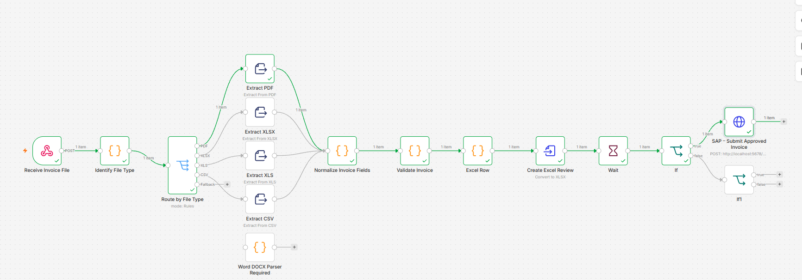

# Automated Invoice Processing with n8n | ConvergLeads

**AI Automation. One Platform. Endless Possibilities.**

## 🚀 Overview

This project demonstrates an automated invoice processing workflow built with **n8n** under the ConvergLeads brand.

The solution automates several steps of invoice processing, from receiving an invoice file to extracting and validating invoice data, requesting human approval, and sending approved invoice data to a simulated SAP environment.

The goal is to reduce manual tasks, improve data consistency, and make invoice processing more efficient.

## 🎥 Demo Videos

Watch the project demonstrations on LinkedIn:

- **English Demo:** [Watch the Automated Invoice Processing Demo](https://www.linkedin.com/posts/esther-madianga_n8n-workflowautomation-businessautomation-ugcPost-7526394549091516417-MOHn/)
- **German Demo:** [Automatisierte Rechnungsverarbeitung ansehen](https://www.linkedin.com/posts/esther-madianga_n8n-workflowautomation-businessautomation-ugcPost-7526389925957574656-bMKs/)

## 🏗️ Workflow Architecture

The workflow is designed to automate the invoice processing lifecycle through the following steps:

1. Invoice file reception
2. File type identification
3. Routing based on file type
4. Invoice data extraction
5. Data normalization
6. Invoice validation
7. Excel review file generation
8. Human approval
9. Approval decision processing
10. SAP sandbox submission simulation
11. Rejection handling

## ⚙️ How the Workflow Works

### 1. Receive Invoice File

The workflow receives an invoice file through an n8n webhook.

### 2. Identify File Type

The system identifies the uploaded file format, such as PDF, XLSX, XLS, or CSV.

### 3. Route by File Type

The workflow automatically directs the invoice to the appropriate processing branch.

### 4. Extract Invoice Data

Relevant invoice information is extracted, including:

- Supplier name
- Invoice number
- Invoice date
- Net amount
- VAT amount
- Gross amount
- Currency

### 5. Normalize Invoice Fields

The extracted information is converted into a consistent data structure to simplify further processing.

### 6. Validate Invoice Data

The workflow checks whether required information is available and whether the invoice amounts are consistent.

### 7. Create Excel Review

The extracted invoice information is prepared in an Excel review file for further verification.

### 8. Human Approval

The workflow pauses and waits for a human decision before continuing.

### 9. Approval Decision

An IF condition checks the approval decision:

- **APPROVE:** The invoice continues to the SAP sandbox.
- **REJECT:** The invoice follows the rejection branch.

### 10. SAP Sandbox Integration

For this demonstration, the workflow sends the approved invoice data to a simulated SAP environment.

The sandbox returns a simulated response with a document reference. No invoice is posted to a live production SAP system.

### 11. Rejection Handling

If the invoice is rejected, the workflow follows a separate rejection path instead of continuing to the SAP submission step.

## 🛠️ Technologies Used

- **n8n** – Workflow automation
- **SAP Sandbox Simulation** – Demonstration of the SAP submission process
- **Excel** – Invoice review and data preparation
- **PDF Processing** – Invoice data extraction
- **HTTP Webhooks** – File reception and communication
- **JavaScript** – Data transformation and workflow logic

## 💼 Business Value

This automation demonstrates how businesses can:

- Reduce repetitive manual invoice processing.
- Improve invoice data consistency.
- Automate document classification and data extraction.
- Introduce human approval into automated processes.
- Reduce manual data entry.
- Prepare invoice information for ERP integration.

## 🎯 Potential Use Cases

The workflow concept can be adapted for:

- Accounts payable departments
- Finance and accounting teams
- Small and medium-sized businesses
- Invoice management processes
- Administrative automation
- ERP integration projects

## 🔐 Security and Project Availability

This repository presents the project architecture and its capabilities.

To protect the workflow configuration and business logic:

- The complete workflow JSON is not publicly shared.
- API credentials and access tokens are not included.
- Passwords and sensitive configuration details are excluded.
- Demonstration invoice data are fictitious.

## 📌 Project Status

**Status: Working Demonstration**

The workflow has been developed and tested in an n8n environment.

The SAP integration shown in the demonstration uses a simulated sandbox response. A connection to a live SAP system would require authorized access, appropriate API configuration, and company-specific integration settings.

## 🔮 Future Improvements

Possible future developments include:

- Integration with a live SAP environment.
- Automated email notifications.
- Advanced invoice validation.
- Duplicate invoice detection.
- Improved error handling and logging.
- Additional document formats.
- Extended approval processes.

## 👩‍💻 Author

**Esther Madianga**  
Freelance Automation Specialist

AI Automation | n8n | Business Process Automation | IT Service Management

**ConvergLeads – AI Automation. One Platform. Endless Possibilities.**

---

*This project is an automation demonstration developed to showcase practical business process automation with n8n.*
